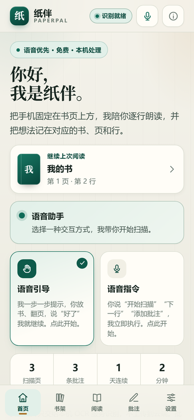
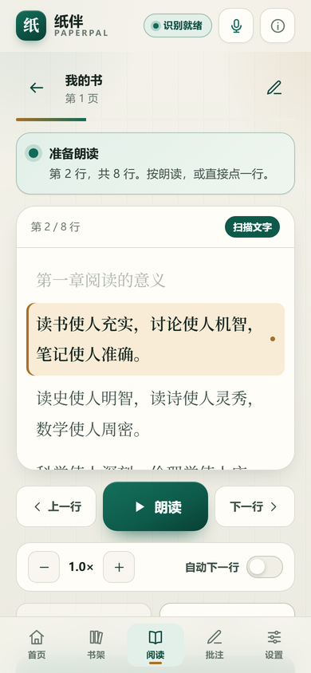
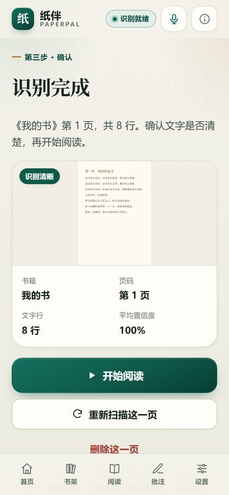
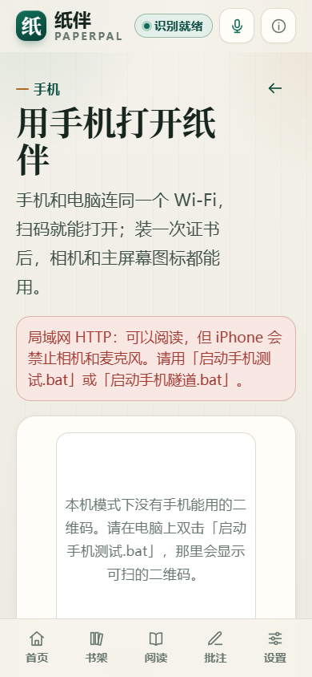
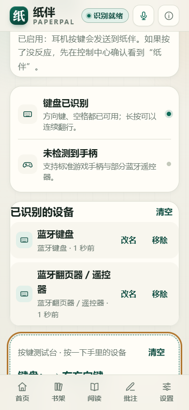
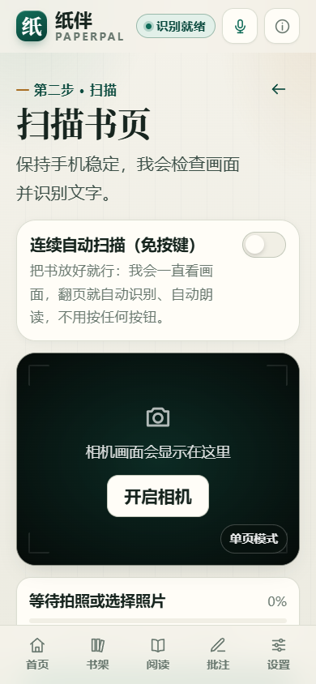

# 纸伴 PaperPal

> 陪你看纸书的语音阅读伙伴。把手机固定在书页上方，纸伴负责看清、朗读、记住；放书和翻页仍然由你完成。

纸伴是一个**语音优先、无障碍优先**的本地应用：相机拍照 → 本机 OCR 识别 → 逐行朗读 → 在对应的书、页、行记录批注。文字与批注保存在本机 SQLite 数据库，可随时导出备份。

项目按 **`前端/`** 和 **`后端/`** 两个文件夹整理；根目录的 **`启动纸伴App.bat`** / **`启动纸伴App.lnk`** 可以直接双击打开独立 App 窗口，**`启动手机测试.bat`** 则以 HTTPS 启动，供手机（iPhone / Android）扫码打开并连接蓝牙耳机测试。

## 四种打开方式

| 场景 | 入口 | 说明 |
| --- | --- | --- |
| 电脑上演示 | `启动纸伴App.bat` | 独立窗口，无地址栏，功能与网页版一致 |
| **手机 + 同一 Wi-Fi** | `启动手机测试.bat` | 局域网 HTTPS + 二维码 + 一键装证书；会自动请求管理员放行防火墙 |
| **手机 + 任意网络（最稳）** | `启动手机隧道.bat` | Cloudflare 公网 HTTPS，手机用 4G/5G 也能开，**不用装证书、不怕校园网隔离** |
| 局域网快速看看 | `后端\start-lan.ps1` | HTTP，能阅读和写批注，但手机上相机不可用（网页版）；**原生 App 用这个最省事** |

## iOS 原生 App（两周汇报方案）

`ios/` 里是一套可在 Xcode 打开的 **SwiftUI 原生 App**，和上面的网页版并存、互不影响：

- **iPhone 负责**：相机、连续自动扫描的节奏、逐行朗读、耳机按键、批注界面；
- **识别优先走 Windows**：调用本仓库已有的 `/api/v1/auto-scan`（RapidOCR，识别率高、批注与进度都存在电脑）；
- **连不上自动降级**：切换成 iPhone 本机的 `Apple Vision` 中文识别，答辩不会开天窗；
- **不需要 HTTPS**：原生 App 的相机不受 Safari 安全上下文限制，局域网 `http://电脑IP:8090` 直接可用。

要求：Mac + Xcode 15/16 + 一个 Apple ID（免费签名 7 天）。完整步骤、三种连接方式、权限配置、排期与演示脚本见 **[ios/README.md](ios/README.md)**。

## 发布到 GitHub Pages（界面演示站）

`docs/` 是从 `前端/` 生成的**静态演示站**：资源路径已改成相对路径（适配 `https://<user>.github.io/<repo>/`），
没有后端时自动进入离线模式并载入演示书籍，点首页「继续上次阅读」即可看到逐行朗读界面。

重新生成（改了前端之后）：

```powershell
python tools\build_pages.py
```

Fork + 推送 + 开启 Pages（一条命令，需要 GitHub token，勾选 `public_repo` 即可）：

```powershell
.\tools\publish_to_github.ps1 -Token ghp_你的token
# 或者：$env:GITHUB_TOKEN="ghp_..."; .\tools\publish_to_github.ps1 -Token $env:GITHUB_TOKEN
```

脚本会：fork `Livia-W/ocr-text-map` → 把本项目 force 推到 `main` → 把 Pages 源设为 `main /docs` → 打印网址。


## 桌面 App 窗口（推荐演示）

纸伴可以不以浏览器标签页运行，而是打开一个**独立桌面窗口**：没有地址栏、没有标签页，窗口标题为“纸伴 · 陪你读书”。底层使用系统 Edge/WebView2 应用模式，界面、语音、扫描和批注功能与网页版完全一致。

### 在 Cursor 里演示

1. 用 Cursor 打开项目文件夹。
2. 右下角选择解释器 **Python 3.12**。
3. 打开根目录的 [run_app.py](run_app.py)，点右上角 **Run**；或打开 Cursor 终端执行：

```powershell
python run_app.py
```

会出现独立的 App 窗口。也可以在 Cursor 的“运行和调试”里选择 **纸伴 · 桌面 App**。

### 直接启动

双击根目录的 **`启动纸伴App.bat`**（或 `启动纸伴App.lnk`），或在项目目录执行：

```powershell
.\后端\start-app.ps1
```

也可以进入后端目录：

```powershell
cd 后端
python -m paperpal desktop
```

- 默认窗口 430×900，可用 `--width` / `--height` 调整。
- 关闭应用窗口后，本地服务自动停止。
- 如果系统没有 Edge，会自动改用 Chrome 或默认浏览器。
- 可选原生 pywebview 窗口：`pip install pywebview`，再执行 `python -m paperpal desktop --backend native`。

> 桌面窗口仍需要在后台启动一个仅监听 `127.0.0.1` 的本机服务（负责 OCR、数据库和静态界面），但用户看到的是一个独立 App 窗口，不是浏览器网页。

## 界面预览

| 首页 | 阅读 | 识别结果 |
| --- | --- | --- |
|  |  |  |

| 手机连接（扫码） | 设备测试台（蓝牙按键） |
| --- | --- |
|  |  |

| 连续自动扫描（免按键） | 阅读（自动播放中） |
| --- | --- |
|  |  |

更多页面（扫描、摆放引导、批注、书架、设置、深色模式）见 [界面预览](前端/docs/screenshots/README.md)。

## 手机实测（推荐：HTTPS + 扫码 + 证书）

手机浏览器（尤其 iPhone Safari）只在 **HTTPS** 下开放相机、麦克风和离线安装，所以纸伴内置了一套一键手机模式：

```powershell
.\启动手机测试.bat          # 局域网 HTTPS（同一 Wi-Fi）
.\启动手机隧道.bat          # 公网 HTTPS（任意网络，最省事）
```

### 方案 A：局域网 HTTPS（`启动手机测试.bat`）

1. 双击脚本：会检查依赖、**弹一次 UAC 请求放行防火墙**（这一步是"手机一直转圈"最常见的原因），然后以 HTTPS（默认 8443）启动，并打开「用手机打开纸伴」页面。
2. 页面中间是**二维码**，手机连同一个 Wi-Fi，用系统相机扫一下即可。
3. 手机上打开「下载证书描述文件」→ 安装 → **设置 → 通用 → 关于本机 → 证书信任设置 → 打开完全信任**（只需一次）。
4. Safari 分享菜单 →「添加到主屏幕」，就是一个全屏 App。
5. 打不开时先试**网络自检** `http://电脑IP:8080`（被占用会自动换到 8081 / 8088，以窗口打印的地址为准）：能看到"网络是通的"就说明防火墙没问题，问题在证书；打不开就是防火墙或 Wi-Fi 隔离。

细节说明：

- 启动时会打印防火墙状态、局域网地址、证书指纹和自检地址；没有管理员权限时会给出可直接粘贴的 `netsh` 命令。
- 如果端口已被上一次没关掉的纸伴占用，脚本会检测到并提示，而不是默默失败。
- 证书是本地自签的（`后端/data/https/`），私钥只留在这台电脑，不会上传；换电脑或删掉该目录会重新生成。
- 电脑开着 Clash 等代理的 **TUN 模式** 时，手机可能连不上，测试前请先关闭。

### 方案 B：公网隧道（`启动手机隧道.bat`，推荐）

校园网、宿舍 Wi-Fi 常有客户端隔离，手机和电脑在同一个 Wi-Fi 也互相访问不到；这种情况下用隧道：

1. 双击 `启动手机隧道.bat`，第一次会自动下载 `cloudflared`（约 55 MB，只下一次）。
2. 脚本会建立一个临时公网 HTTPS 地址（`https://xxxx.trycloudflare.com`），并打印二维码。
3. 手机用 **4G/5G 或任意 Wi-Fi** 扫码即可打开：**不需要安装证书**（证书由 Cloudflare 签发），相机、麦克风、添加到主屏幕全部可用。
4. 隧道地址每次重启都会变，以电脑上的二维码为准；想保护隐私可以同时设置 `PAPERPAL_TOKEN`。

> 之前的"扫了二维码一直加载"几乎都是：① 防火墙没放行（脚本非管理员运行）② 校园网隔离 ③ 电脑代理劫持局域网地址 ④ 上一次的旧进程占着 8443。现在这四种情况都有对应的检测与退路。

完整的操作、排障与盲人用户测试脚本见 [手机与蓝牙实测指南.md](手机与蓝牙实测指南.md)。

### 网页版（电脑本机 / 局域网 HTTP）

不装证书也能用：阅读、听书、写批注都正常，只是手机上**相机与离线安装会被浏览器禁止**。

```powershell
.\后端\start.ps1                        # 本机 http://127.0.0.1:8000
.\后端\start-lan.ps1 -Port 8090         # 局域网 http://电脑IP:8090（8080 常被代理占用）
```

- 应用：<http://127.0.0.1:8000> · API 文档：<http://127.0.0.1:8000/docs> · 服务状态：<http://127.0.0.1:8000/api/v1/health>
- 手机用 HTTP 时可以用「从相册选择照片」扫描书页，实时取景需要 HTTPS。

### 手动启动

```powershell
cd 后端
python -m venv .venv
.\.venv\Scripts\python.exe -m pip install -r requirements.txt
.\.venv\Scripts\python.exe -m paperpal serve --host 127.0.0.1 --port 8000
.\.venv\Scripts\python.exe -m paperpal phone --port 8443     # HTTPS 手机模式
```

### 开发与测试

```powershell
cd 后端
.\.venv\Scripts\python.exe -m pip install -r requirements-dev.txt
cd ..
.\后端\.venv\Scripts\python.exe -m pytest
```

后端测试使用假的 OCR 引擎，不需要下载模型；真正扫描时才加载 RapidOCR。

---

## 蓝牙耳机 / 翻页器 / 手柄

| 输入方式 | 支持情况 | 怎么用 |
| --- | --- | --- |
| **蓝牙耳机**（AirPods、普通蓝牙耳机） | iPhone / Android / 桌面 | 系统蓝牙连上耳机 → 纸伴里点一次「启用耳机按键」（MediaSession）→ 播放/暂停键停读与续读，上一首/下一首翻行；iPhone 控制中心会显示“纸伴 · 书名 · 第几行” |
| **蓝牙键盘 / 翻页器 / 遥控器**（HID） | 全部平台 | 系统里配对即可，不用在纸伴里连；方向键、PageUp/PageDown、空格、N、Esc；**长按 ← → 连续翻行** |
| **游戏手柄** | iPhone 16.4+ / Android / 桌面 | Gamepad API：十字键翻行，A 暂停/继续，B 返回，X 加批注 |
| **Web Bluetooth BLE 设备** | Android / 桌面 Edge·Chrome | 设备页可直接连接；耳机和大多数翻页器不是 BLE GATT 设备，所以**在网页里搜不到是正常的**——请走上面的系统配对 |

**系统配对三步（设备页可直接操作）**：① 在系统蓝牙里配对 → ② 点「开始侦测按键」按一下设备 → ③ 当场给它起名字。
侦测期间纸伴会自动启用耳机媒体键；收到按键立刻登记并高亮第 3 步，改完名字后所有提示（设备列表、按键日志、耳机状态）都用这个昵称。

**设备昵称（不再显示端口 / UUID）**：纸伴不要求"在网页里连上设备"，而是**按真实收到的按键登记设备**：收到耳机媒体键就登记「蓝牙耳机」，收到方向键就登记「翻页器 / 键盘」，手柄与 BLE 设备用系统名字。每个设备都可以改名成「我的耳机」「桌上的翻页器」，界面和语音提示只用这个名字。

「设备测试台」会把每个按键的**来源、名称、时间和对应动作**列出来并用语音念出来，方便在没有专业工具的情况下确认“手里的设备到底有没有把按键送到纸伴”，也方便给盲人用户做现场确认。


## 功能

### 阅读

- **连续自动扫描（免按键）**：打开后相机一直盯着书页，本地判断"清不清楚、有没有变化"，稳定时才识别；翻页自动识别新的一页并从第一行开始朗读，往回翻也能认出来，不用拍照、不用点下一步。
- 自动模式会**保留阅读位置**：同一页重新识别时按文字匹配找回原来那一行，不会因为重扫而错行。
- 语音引导 / 语音指令双模式：引导模式一步步提示“摆好书 → 说好了 → 检查”；指令模式直接说“开始扫描”“下一行”“添加批注”。
- 逐行朗读、上一行 / 下一行、暂停 / 继续、语速与音高调节。
- **三种阅读模式**：手动点读；整页连续（读完本页自动停）；整夜阅读（自动翻行、翻到下一页，屏幕常亮并降低亮度）。
- **阅读进度自动保存**：每次翻行保存书 / 页 / 行；来电、切后台、关闭页面前立即落盘，回来后按朗读继续。
- **简体 / 繁体**阅读显示与朗读；可选 **中文→英文** 或 **英文→中文** 译文，逐行显示，可单独朗读译文。
- 点击任意一行即可跳到该行朗读，朗读位置与高亮同步。
- 自动记住书、页、行，下次打开继续读；最近读过的一页会缓存到本机，断网也能继续朗读。

- **蓝牙耳机 / 键盘 / 翻页器 / 手柄**：耳机走 MediaSession（播放暂停、上一首/下一首控制朗读，锁屏与 iPhone 控制中心可见）；键盘和翻页器按 HID 直接生效，长按方向键连续翻行；支持 Web Bluetooth 的安卓/桌面可以连接 BLE 设备、显示昵称与电量并学习按键。
- 键盘与手柄：方向键、`PageUp`/`PageDown`、空格暂停、`N` 加批注、`Esc` 返回；标准游戏手柄会显示设备 ID。
- **设备测试台**：实时列出每个按键的来源、名称和时间，并用语音念出来，方便现场确认蓝牙设备是否生效。
- 可安装为 PWA：应用外壳离线可用，书页与批注在恢复连接后自动同步。

### 扫描与识别

- **免按键自动扫描**：连续取帧 + 稳定性判断 + 页面相似度比对，自动判断"同一页 / 翻页了 / 往回翻"；同一页就地在原页更新（批注和页码都保留），几乎没变化时直接跳过、不重复写库。
- 也保留手动方式：摄像头实时取景、补光（设备支持时）、相册照片；大图与 HEIC 会在浏览器内自动转成 JPEG 并压缩。
- 单页 / 左右双页 / 左右双栏，以及 0°/90°/180°/270° 方向校准。
- 服务端复用原有 `mobile_ocr` 的 RapidOCR、页面校正、分区和阅读顺序算法。
- 识别结果页展示置信度、文字预览和回退提示；可重扫、删除。
- 同一页重扫会复用页面 ID，已有批注不会丢失。
- 书架支持改名、删除、搜索，按最近阅读排序。

### 批注与数据

- 批注按书 / 页 / 行或整页保存，支持听取、补充、编辑、删除、搜索。
- 保存前语音回读范围和内容，再次确认才写入。
- 离线时批注先写入本机队列，联网后自动同步（PWA + Service Worker）。
- 导出 / 导入完整 JSON 备份；清除数据保留设置。
- 统计：扫描页数、文字行数、批注数、连续阅读天数、每日阅读时长。

### 无障碍

- 主要触控目标 52–60 px，图标按钮不小于 44 px；清晰焦点环、高对比度开关、字号 85%–160% 缩放。
- 全站语义化标签、`aria-live` 状态、跳转链接、原生 `<dialog>` 焦点管理。
- **读屏模式**：关闭应用朗读，把播报交给 VoiceOver / TalkBack，避免双重朗读。
- 每个关键操作都有按钮替代语音和手势；语音失败时始终可以打字。
- **不碰屏幕也能读完一页**：耳机按键、蓝牙键盘、翻页器、手柄、长按连发都能翻行、暂停和加批注。
- **会说话的设备测试台**：每个按键都会被念出来，盲人用户可以自己确认设备是否连对。
- 支持 `prefers-reduced-motion` 与强制颜色模式。
- 手机接入页提供二维码、证书一键安装和排障清单，避免“让视障用户自己输网址”。

---

## 项目结构

```
.
├── 前端/                      # 前端应用（HTML / CSS / ES Modules / PWA）
│   ├── index.html             # 全部页面与图标精灵
│   ├── styles.css             # 设计系统：令牌、组件、深色、高对比
│   ├── js/
│   │   ├── api.js             # REST 客户端、XHR 上传进度、错误类型
│   │   ├── store.js           # 状态、localStorage 缓存、离线队列
│   │   ├── voice.js           # 朗读、语音识别、中文指令解析、iOS 保活
│   │   ├── input.js           # 统一输入层：媒体键 / 键盘 / 手柄 / 长按连发
│   │   ├── media.js           # MediaSession 桥：蓝牙耳机按键控制朗读
│   │   ├── autoscan.js        # 免按键连续取帧、稳定性判断与上传
│   │   ├── devices.js         # 设备登记簿：按真实按键登记设备并起昵称
│   │   ├── bluetooth.js       # Web Bluetooth 连接、昵称、电量、按键
│   │   ├── ui.js              # DOM、Toast、对话框、日期、读屏播报
│   │   └── app.js             # 路由、视图、相机、扫描、阅读、设置
│   ├── sw.js                  # Service Worker（外壳离线，API 不缓存）
│   ├── manifest.webmanifest   # PWA 清单与快捷方式
│   ├── icon-180/192/512.png   # iPhone / PWA 主屏幕图标
│   ├── icon*.svg              # 矢量应用图标
│   ├── docs/screenshots/      # 界面预览截图
│   └── design/                # 设计交付文件
├── 后端/                      # 后端、OCR 与桌面启动器
│   ├── paperpal/              # FastAPI / SQLite 应用与桌面启动器
│   │   ├── api.py             # v1 路由、静态托管、安全头
│   │   ├── text.py            # 繁简转换与可选在线翻译
│   │   ├── desktop.py         # 桌面 App 窗口
│   │   ├── certs.py           # 纯 Python 自签 CA / 服务器证书 / iOS 描述文件
│   │   ├── phone.py           # 局域网地址、二维码、防火墙、诊断端口
│   │   ├── tunnel.py          # Cloudflare 公网隧道（手机任意网络可访问）
│   │   ├── autoscan.py        # 同一页 / 翻页 的相似度判定
│   │   ├── selfcheck.py       # OCR 自检与环境诊断
│   │   ├── db.py              # SQLite 结构、迁移、演示数据
│   │   ├── repository.py      # 书架 / 书页 / 批注 / 进度 / 统计
│   │   ├── ocr.py             # RapidOCR 适配器
│   │   ├── storage.py         # 书页图片与缩略图
│   │   └── config.py          # 路径、设置校验、鉴权开关
│   ├── ocr-text-map-main/     # 原有 OCR 与版面分析模块（B 模块）
│   ├── tests/                 # 后端接口测试（含手机接入测试）
│   ├── data/                  # SQLite 数据库、书页图片、https 证书
│   ├── requirements*.txt
│   ├── start.ps1             # 网页版启动
│   ├── start-lan.ps1         # 手机 / iPhone 局域网访问（HTTP）
│   ├── start-phone.ps1       # 手机测试模式（HTTPS + 证书 + 二维码 + 防火墙）
│   ├── start-tunnel.ps1      # 公网隧道模式（cloudflared）
│   ├── tools/                # cloudflared.exe（首次跑隧道时自动下载）
│   └── start-app.ps1 / .bat  # 桌面 App 启动
├── run_app.py                 # Cursor / Python 一键启动桌面 App
├── 启动纸伴App.bat / .lnk      # 双击启动入口
├── 启动手机测试.bat            # 双击进入手机测试模式（局域网 HTTPS）
├── 启动手机隧道.bat            # 双击进入公网隧道模式（任意网络可打开）
├── ios/                       # iOS 原生 App（SwiftUI，Xcode 打开；见 ios/README.md）
├── 手机与蓝牙实测指南.md        # 手机接入、蓝牙测试与盲人用户测试脚本
├── .runtime/                  # 本机运行依赖缓存（首次安装后生成）
├── .vscode/launch.json        # Cursor / VS Code 调试配置
└── README.md
```

数据默认写入 `后端/data/`：

```
后端/data/
├── paperpal.db       # SQLite（WAL）
├── images/           # 原始书页、缩略图、校正预览
└── https/            # 本机 CA 与服务器证书（手机信任用）
```

可用 `PAPERPAL_DATA_DIR` 改变位置，或用 `PAPERPAL_DB` 单独指定数据库。

---

## API 一览

所有接口前缀 `/api/v1`。详细字段见 `/docs`。

| 方法 | 路径 | 说明 |
| --- | --- | --- |
| GET | `/health` | 服务与 OCR 状态（公开） |
| GET | `/bootstrap` | 启动时一次取回档案、设置、书架、进度、批注、统计 |
| GET | `/phone` | 手机接入信息：局域网地址、二维码 SVG、证书指纹、安装步骤 |
| GET | `/diagnostics` | 环境快照：Python、依赖、OCR、数据目录、证书 |
| POST | `/ocr/self-test` | 用后端生成的测试图片跑一次真实 OCR（排障用） |
| GET/PATCH | `/profile` | 读取 / 修改称呼 |
| GET/PUT | `/settings` | 读取 / 更新设置（服务端校验范围） |
| GET/POST | `/books` | 书架列表 / 新建书籍 |
| GET/PATCH/DELETE | `/books/{id}` | 书籍详情 / 修改 / 删除 |
| POST | `/books/{id}/pages` | 上传图片原始二进制并识别，参数：`page_number`、`layout`、`rotation`、`mode`、`min_confidence` |
| POST | `/books/{id}/auto-scan` | 免按键连续扫描：自动判断「同一页 / 翻页 / 往回翻」，同一页就地更新 |
| GET | `/books/{id}/pages/{page}` | 按页码取书页 |
| GET/DELETE | `/pages/{id}` | 书页详情 / 删除 |
| GET | `/pages/{id}/image?kind=original\|thumb\|rectified` | 书页图片 |
| GET/POST | `/notes` | 批注列表（`q`、`scope`、`book_id`）/ 新建 |
| PATCH/DELETE | `/notes/{id}` | 修改 / 删除批注 |
| GET/PUT | `/progress` | 阅读进度（`POST` 为 `sendBeacon` 别名） |
| POST | `/text/transform` | 繁简转换与可选译文（`lines`、`script`、`translation`） |
| POST | `/activity` | 记录阅读时长与行数 |
| GET | `/stats?days=14` | 阅读统计与连续天数 |
| GET | `/export` | 导出 JSON 备份 |
| POST | `/import?mode=merge\|replace` | 导入备份 |
| DELETE | `/data` | 清除数据（保留设置） |
| POST | `/demo-book` | 恢复演示书籍 |

兼容旧接口：`/api/health` 与 `/api/ocr` 仍然可用，原来的 `mobile_ocr` 调试页挂在 `/static`。

### 手机信任证书（公开，无需令牌）

| 方法 | 路径 | 说明 |
| --- | --- | --- |
| GET | `/paperpal-ca.crt` | 下载本机 CA 证书（PEM），Android / 桌面手动信任用 |
| GET | `/paperpal.mobileconfig` | iOS 描述文件，Safari 打开即可一键安装 |

### 可选访问令牌

设置环境变量 `PAPERPAL_TOKEN` 后，除 `/api/health` 外的 `/api/v1/*` 都需要：

```
Authorization: Bearer <token>
```

前端会读取 `localStorage.paperpal.token` 并自动附加。适合通过局域网或反向代理暴露服务时使用。

---

## OCR 与隐私

- 页面照片只发送到本机 FastAPI 服务，不经过云端；服务端把原图保存到 `后端/data/images/`，只用于预览和重扫。
- RapidOCR 模型在第一次扫描时加载，因此首次识别明显更慢；之后会复用进程内实例。
- 单张图片上限 8 MiB；接口忙碌时返回 503，前端提示稍后重试。
- 语音识别（Web Speech API）是否走云端取决于浏览器实现；如不希望使用，可关闭语音指令并只使用按钮或键盘。
- 无账号、无遥测。默认没有任何第三方请求；只有在设置中主动开启翻译后，才会把**当前页文字**发送到在线翻译服务。关闭翻译后不会发送，照片、批注和整本书不会上传。

### 在线翻译（可选）

- 依次尝试 MyMemory 与 Google 免费接口，任一可用即返回；连不上的提供方会在本次运行内被跳过，避免每条都等超时。
- 想用自己的翻译服务（LibreTranslate 兼容）：设置环境变量 `PAPERPAL_TRANSLATE_URL=http://127.0.0.1:5000/translate`。
- 完全不想联网：`PAPERPAL_TRANSLATE_PROVIDER=off`，此时译文选项会提示“已被管理员关闭”，繁简转换仍然完全在本机完成。
- 翻译不可用时只影响译文，原文与朗读不受影响。

---

## 与原有模块的关系

`后端/ocr-text-map-main` 中的 B 模块（方向/分区校准、页面校正、OCR、阅读顺序、坐标映射）保持原样，被新后端 `后端/paperpal/ocr.py` 复用：

```
相机/相册 → 前端压缩上传 → paperpal.api → mobile_ocr.OCRPipeline
        → 行级文字 + 置信度 + 坐标 → SQLite + 前端逐行朗读
```

`后端/ocr-text-map-main/docs/INTEGRATION.md` 中的 `document_id`、`regions`、`lines`、`blocks` 契约仍然成立；新后端只保存行文本、阅读顺序、置信度、区域/块编号和 `bbox_source`，原图和校正图保存为文件。

---

## 常见问题

**手机上扫码后一直转圈、什么都不显示？** 按顺序排查（手机页面里也有同样的清单和一键"网络自检"）：
1. 电脑上双击 `启动手机测试.bat` 时是否点了 UAC 的"是"？脚本会打印"防火墙：已放行/未放行"。
2. 手机打开窗口里打印的**网络自检**地址（通常是 `http://电脑IP:8080`，被占用时是 8081/8088）：能看到"网络是通的"→ 防火墙没问题，回去看证书；打不开 → 防火墙或 Wi-Fi 隔离。
3. 关掉电脑上的 Clash / VPN（TUN 模式会劫持局域网地址）。
4. 还不行就用 `启动手机隧道.bat`：公网 HTTPS、不用证书、4G 也能开。
5. 别忘了上一次没关掉的纸伴可能正占着 8443，脚本会提示"已经在运行"。

**蓝牙设备在网页里搜不到？** 这是正常的：蓝牙耳机、绝大多数翻页器/遥控器是系统 HID 或经典蓝牙设备，浏览器的 Web Bluetooth 看不到它们。请先在**系统设置 → 蓝牙**里配对，再回到纸伴的「设备测试台」按一下设备按键，纸伴会自动登记它，并显示昵称（可改名），不会显示端口或 UUID。

**自动扫描会误认成新的一页吗？** 不会：同一页的相似度阈值是 0.72，几乎没变化（0.97 以上）时直接跳过不写库；重新识别同一页时会按文字找回原来那一行，不会错行。

**相机没有画面？** 手机必须用 `https://` 打开（`启动手机测试.bat` 或隧道模式）；检查浏览器相机权限；iOS 还需要“设置 → Safari → 相机”。微信等 App 的内置浏览器不能装证书，请用系统 Safari。

**手机上提示“不安全”？** 局域网模式还没装描述文件，或装了但没在「设置 → 通用 → 关于本机 → 证书信任设置」里打开完全信任。不想折腾证书就用 `启动手机隧道.bat`，公网证书自动受信任。

**相机提示被占用？** 关掉其它正在使用相机的 App，或重启 Safari。

**耳机按键没反应？** 先在系统蓝牙里连上耳机，再在纸伴里点一次「启用耳机按键」；确认 iPhone 控制中心能看到“纸伴”。部分耳机把双击/长按放在自己的固件里，不会传给手机，这种只能换耳机或改用蓝牙键盘/翻页器。详见 [手机与蓝牙实测指南.md](手机与蓝牙实测指南.md) 第 3 节。

**语音没有声音 / 语音指令没反应？** iOS 要求先点一下页面才允许朗读；检查静音开关与音量。语音指令必须 HTTPS 并允许麦克风。

**第一次识别很慢？** RapidOCR 首次加载模型并初始化 ONNX Runtime，通常 10–40 秒，之后恢复正常。

**识别不出文字？** 先在「设置 → 关于纸伴 → 自检识别引擎」跑一次自检：它会用一张程序生成的测试图片验证整条 OCR 链路，并给出用时和识别结果。再检查方向、双页/双栏分区、光线与对焦。

**批注没有同步？** 顶栏显示“离线”时，批注先保存在本机队列；恢复连接后自动同步，也可以在批注库看到“待同步”标记。

**想换电脑？** 在设置 → 数据 → 导出备份；手机上会走系统分享面板，选“存储到文件”即可。导入书籍的文字和批注会恢复；原图与缩略图不包含在备份中。

**同一个 Wi-Fi 里有别人，怎么保护数据？** 启动前设置环境变量 `PAPERPAL_TOKEN=你的口令`，然后在「设置 → 关于纸伴 → 访问令牌」里填入同一个口令。

**桌面窗口没有出现？** 确认系统已安装 Microsoft Edge；在 Cursor 中确认解释器是 Python 3.12；再在项目终端运行 `python run_app.py --backend app` 查看错误。若仍然只打开浏览器，请使用 `.\后端\start-app.ps1` 或把 Edge 设为默认浏览器。

**桌面窗口和网页版有什么区别？** 内容完全相同；桌面版是一个没有地址栏/标签页的独立窗口，适合在 Cursor 或课堂演示。网页版适合手机通过 Wi-Fi 访问。

---

## 许可

本项目为交互设计课程作品。`后端/ocr-text-map-main` 的上游许可与说明见该目录内的 README。
